# U-DICE

Aplicación Android en Kotlin y Jetpack Compose para consultar y publicar avisos universitarios. Los lectores pueden filtrar el feed, buscar avisos por texto o fecha, reaccionar y guardar avisos. Las cuentas ASO pueden crear y editar sus avisos, adjuntar hasta cuatro imágenes o un video y elegir qué reacciones ofrecen. Los administradores gestionan las cuentas ASO y el catálogo de reacciones.

## Compilación

Abre el proyecto en Android Studio con el SDK configurado. El modo Supabase lee la URL del proyecto y su clave **Publishable** desde `local.properties`, en la raíz del repositorio:

```properties
UDICE_SUPABASE_URL=https://tu-proyecto.supabase.co
UDICE_SUPABASE_PUBLISHABLE_KEY=sb_publishable_TU_CLAVE
```

Ejecuta `./gradlew assembleDebug` (en Windows, `.\gradlew assembleDebug`). La variante local se puede compilar sin esa configuración con `-PudiceSupabase=false`.


## Arquitectura y datos

```mermaid
flowchart TD
    subgraph UI["Interfaz · Jetpack Compose y Material 3"]
        Main["MainActivity<br/>Hilt y enlace de confirmación"] --> App["UDiceApp<br/>AuthStateHolder y SessionState"]
        App -->|"Sin sesión"| Auth["AuthScreen<br/>Registro e inicio de sesión"]
        App -->|"Con sesión"| Nav["SignedInApp<br/>Scaffold, barras y NavHost"]

        Nav -->|"ADMIN"| Admin["AdminRoute<br/>AdminStateHolder → AdminScreen"]
        Nav --> Feed["InicioFeedRoute<br/>InicioFeedStateHolder → InicioFeedScreen"]
        Nav --> Search["BusquedaRoute<br/>Texto, categoría, facultad y fechas"]
        Nav --> Pref["PreferenciasRoute<br/>PreferenciasStateHolder → PreferenciasScreen"]
        Nav -->|"ASO"| New["NuevaPublicacionRoute<br/>NuevaPublicacionStateHolder → NuevaPublicacionScreen"]
        Nav --> Profile["PerfilScreen y PerfilStateHolder<br/>Foto, guardados, avisos y conexiones"]
        Profile --> Own["MisPublicacionesRoute<br/>MisPublicacionesStateHolder → MisPublicacionesScreen"]
        Profile --> Saved["GuardadosRoute<br/>GuardadosStateHolder → GuardadosScreen"]
        Feed --> Card["PostCard<br/>Foto del autor, reacciones y guardado"]
        Card --> Detail["DetallePublicacionRoute<br/>DetallePublicacionStateHolder → DetallePublicacionScreen"]
        Saved --> Detail
        Own --> Detail

        New --> Picker["Selector de Android<br/>Hasta cuatro fotos o un MP4"]
        New --> Gallery["Galería cuadrada y visor deslizable<br/>Coil y Compose HorizontalPager"]
        Card --> PublicProfile["Perfil del publicador<br/>Seguir, total de seguidores y avisos paginados"]
        Search --> PublicProfile
        PublicProfile --> Detail
        Profile --> Connections["Siguiendo y Seguidores<br/>Listas privadas paginadas"]
        Card --> Gallery
        Detail --> Gallery
        Detail --> Player["Media3 ExoPlayer<br/>Reproducción bajo demanda"]
        Card --> Player
        Detail --> People["Panel de reacciones<br/>Participantes, avatares y filtros por emoji"]
    end

    subgraph DATA["Repositorios, persistencia y sincronización"]
        Session["SessionRepository"]
        CloudSession["CloudSessionRepository<br/>Sesión y renovación en memoria"]
        LocalSession["SessionRepositoryImpl<br/>Sesión de desarrollo"]
        Posts["PostRepository<br/>PostRepositoryImpl"]
        PrefRepo["PreferencesRepository<br/>PreferencesRepositoryImpl"]
        SavedRepo["SavedPostsRepository<br/>SavedPostsRepositoryImpl"]
        Votes["ReactionsRepository<br/>ReactionsRepositoryImpl"]

        Session -->|"Modo Supabase"| CloudSession
        Session -->|"Modo local"| LocalSession
        Posts -->|"Flow de avisos y caché"| Local["LocalDataSource<br/>RoomLocalDataSource"]
        Posts -->|"CRUD y sincronización paginada"| Remote["RemoteDataSource<br/>SupabaseRemoteDataSource"]
        Posts --> Media["PublicationImageStorage<br/>Carga de fotos, MP4 y miniaturas"]
        LocalSession --> Local
        PrefRepo -->|"Preferencias por cuenta"| Local
        SavedRepo -->|"Guardados por cuenta"| Local
        Local --> Room["Room · UDiceDatabase v8<br/>PostDao, UserDao, PreferenceDao,<br/>SavedPostDao y ReaccionDao"]
        Publishers["PublisherRepository<br/>Perfiles y seguimientos"] --> HTTP
        Votes -->|"ReaccionDao: votos y catálogo"| Room
        Seed["SeedDataCallback<br/>Datos iniciales de desarrollo"] -. "Solo modo local" .-> Room
        CloudSession -->|"Foto de perfil"| Media
        CloudSession --> HTTP["CloudHttpClient<br/>Peticiones HTTPS con token"]
        Remote --> HTTP
        Votes --> HTTP
        Media --> HTTP
    end

    App --> Session
    Admin --> Session
    Admin --> Votes
    Search --> Posts
    Feed --> Posts
    Feed --> PrefRepo
    Feed --> SavedRepo
    Feed --> Votes
    Pref --> PrefRepo
    New --> Posts
    Own --> Posts
    Own -->|"Catálogo de emojis"| Votes
    Saved --> SavedRepo
    Detail --> Posts
    Detail --> SavedRepo
    Profile --> Session
    People --> Votes
    Search --> Publishers
    PublicProfile --> Publishers
    Connections --> Publishers

    subgraph CLOUD["Supabase"]
        AuthAPI["Auth<br/>Registro, confirmación y tokens"]
        REST["PostgREST<br/>Publicaciones, perfiles y catálogo"]
        RPC["RPC de votos, búsqueda, perfiles y seguimiento<br/>Emojis por aviso y resultados paginados"]
        Edge["Edge Function udice-faculty-admin<br/>Gestión de cuentas ASO"]
        Storage["Storage<br/>publicaciones-imagenes, publicaciones-videos y perfiles-imagenes"]
        Policies["RLS y permisos de base de datos<br/>Lectura autenticada y escrituras por autor"]
        REST --> Policies
        Storage --> StoragePolicy["Políticas de Storage<br/>Escritura en carpeta propia y lectura por URL"]
    end

    HTTP --> AuthAPI
    HTTP --> REST
    HTTP --> RPC
    HTTP --> Edge
    HTTP --> Storage
    Gallery -. "Carga por URL" .-> Storage
    Player -. "Lee MP4 por HTTPS" .-> Storage
    AuthAPI -. "Confirmación de correo" .-> Main

    subgraph DI["Inyección de dependencias y concurrencia"]
        Hilt["Hilt y KSP"] --> Modules["SessionModule, RepositoryModule,<br/>DataSourceModule, DatabaseModule y CoroutinesModule"]
        Modules --> IO["@IoDispatcher · Dispatchers.IO"]
        Config["local.properties → BuildConfig<br/>URL y clave publishable"]
    end

    Modules -. "Inyección" .-> Session
    Modules -. "Inyección" .-> Posts
    IO -. "withContext y flowOn" .-> Local
    IO -. "Peticiones HTTPS" .-> HTTP
    Config -. "Configuración de Supabase" .-> HTTP
```



- **Avisos.** Supabase recibe los cambios y Room expone el estado reactivo a la interfaz. El feed empieza con hasta 50 avisos y carga más al llegar al final. Cada página actualiza Room. Ante un fallo de red se conserva la última copia.
- **Guardados y preferencias.** Se almacenan por cuenta en Room y permanecen en el dispositivo.
- **Registro.** Supabase solicita verificar el correo. El enlace abre U-DICE y el usuario puede iniciar sesión con su contraseña.
- **Feed.** Toca Inicio o cambia de categoría para volver al aviso más reciente de la lista. Tira de la lista desde el borde superior para actualizarla. También se sincroniza al volver tras al menos 60 segundos en segundo plano.
- **Búsqueda.** Supabase devuelve resúmenes de 20 en 20. Los filtros combinan categoría, facultad y fechas. Si el aviso no está en Room, se descarga al abrir su detalle.
- **Edición.** Los autores pueden editar texto, emojis y archivos desde un mismo diálogo. En sus tarjetas del feed, el menú permite editar o eliminar.
- **Imágenes.** Se seleccionan hasta cuatro por aviso y se agrupan en un bloque cuadrado en el formulario, el feed y el detalle. El bucket admite JPG, PNG y WebP de hasta 5 MiB. La lectura por URL es pública y las operaciones de escritura están protegidas por RLS.
- **Videos.** MP4 opcional de hasta 20 MiB por aviso, sin límite de duración. Pulsa ▶ sobre la miniatura para reproducir en el feed o en el detalle con Media3 ExoPlayer. El video se detiene al salir de la pantalla.
- **Reacciones.** Los autores eligen del catálogo qué emojis habilitar. El total abre un panel de participantes en el detalle con nombre, foto y filtro por emoji.
- **Siguiendo.** Busca publicadores en Personas o toca su foto en el feed. Desde su perfil puedes seguirlos y abrir sus avisos. La vista Siguiendo muestra sus publicaciones. El mensaje de lista vacía aparece después de que se confirme que no hay publicaciones para mostrar. El perfil público y las tarjetas de Personas incluyen el total de seguidores.
- **Perfil.** Lectores y publicadores pueden cambiar su foto en Mi perfil. El feed usa la foto del autor y muestra sus iniciales cuando no hay foto. En Mi perfil, toca los contadores de Siguiendo o Seguidores para consultar tus listas.

Consulta [el contexto de arquitectura](CONTEXTO_SESION_ARQUITECTURA.md#historial-del-esquema-desplegado) para ver las migraciones, funciones y políticas de Supabase.
