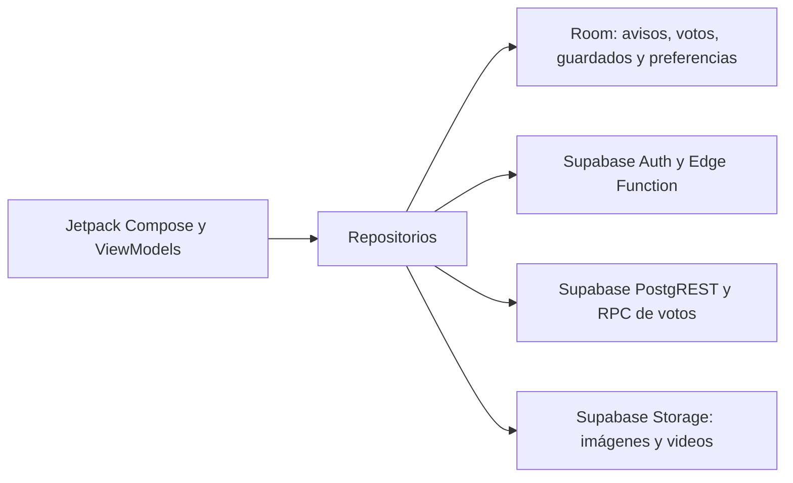

# U-DICE

Aplicación Android en Kotlin y Jetpack Compose para consultar y publicar avisos universitarios. Los lectores pueden filtrar el feed, reaccionar y guardar avisos. Las cuentas ASO pueden crear y editar sus avisos, adjuntar una imagen o un video y elegir qué reacciones ofrecen. Los administradores gestionan las cuentas ASO y el catálogo de reacciones.

## Compilación

Abre el proyecto en Android Studio con el SDK configurado y ejecuta `./gradlew assembleDebug` (en Windows, `.\gradlew assembleDebug`). El proyecto usa Supabase por defecto. La variante local de desarrollo se puede compilar con `-PudiceSupabase=false`.

## Arquitectura y datos

- **Avisos.** Supabase recibe los cambios y Room expone el estado reactivo a la interfaz. Una sincronización exitosa actualiza la caché completa. Ante un fallo de red se conserva la última copia.
- **Guardados y preferencias.** Se almacenan por cuenta en Room y permanecen en el dispositivo.
- **Registro.** Supabase solicita verificar el correo. El enlace abre U-DICE y el usuario puede iniciar sesión con su contraseña.
- **Feed.** Vuelve al inicio al actualizarse y sincroniza al volver después de al menos 60 segundos con el feed en segundo plano.
- **Imágenes.** Se seleccionan desde Android y se muestran en el feed y el detalle. El bucket admite JPG, PNG y WebP de hasta 5 MiB. La lectura por URL es pública y las operaciones de escritura están protegidas por RLS.
- **Videos.** MP4 opcional de hasta 20 MiB por aviso, sin límite de duración. La app genera una miniatura y reproduce el video bajo demanda en el detalle con Media3 ExoPlayer.
- **Reacciones.** Los autores eligen de un catálogo compartido desde Mis publicaciones. Supabase valida la selección al guardar cada voto.

Consulta [el contexto de arquitectura](CONTEXTO_SESION_ARQUITECTURA.md) para detalles de implementación y despliegue.
